<div align="center" dir="rtl">

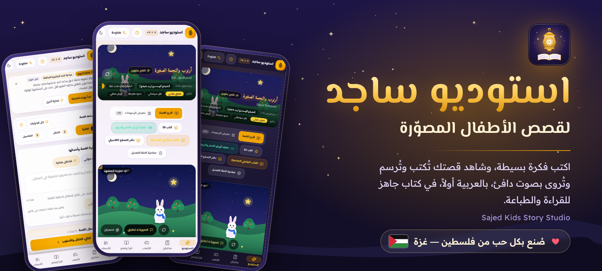

<br><br>

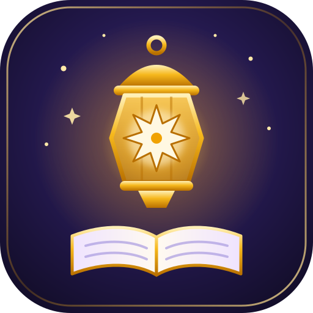

# استوديو ساجد لقصص الأطفال

**اكتب فكرة بسيطة، وشاهد قصتك تُكتب وتُرسم وتُروى بصوت دافئ، بالعربية أولاً.**

الإصدار 3.4.1 &nbsp;|&nbsp; تطبيق ويب تقدّمي (PWA) &nbsp;|&nbsp; واجهة عربية وإنجليزية &nbsp;|&nbsp; [English](README.en.md)

</div>

<div dir="rtl">

## نبذة

استوديو ساجد منصة عربية لصناعة قصص الأطفال المصوّرة. يكتب الأهل أو المعلّم فكرة من سطر واحد، فيبني الاستوديو قصة كاملة بشخصيات ثابتة المظهر عبر الصفحات، ويرسم لكل صفحة مشهدها، ويقرؤها بصوت راوٍ باللهجة المختارة، ثم يسلّمها كتاباً جاهزاً للقراءة على الشاشة أو للطباعة.

صُمّم التطبيق للهاتف أولاً، ويعمل من اليمين إلى اليسار بشكل كامل، وتبقى مكتبة القصص على جهاز المستخدم.

## لقطات من التطبيق

> هذه لقطات حيّة من واجهة الإصدار 3.1.0 (الواجهة الأساسية لم تتغيّر في 3.4.0) أُخذت من التطبيق وهو يعمل. الرسوم داخل القصة المعروضة (الأرنب «أرنوب») رسوم عيّنة لأغراض العرض فقط، وليست ناتج توليد حقيقي.

<table align="center" dir="rtl">
  <tr>
    <td align="center" width="25%">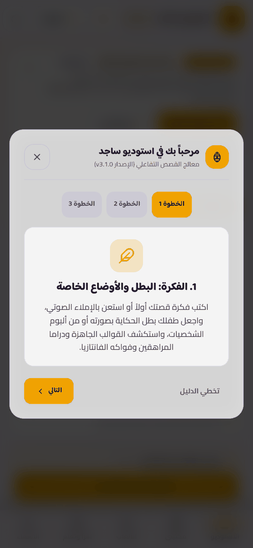<br><sub>دليل البداية</sub></td>
    <td align="center" width="25%">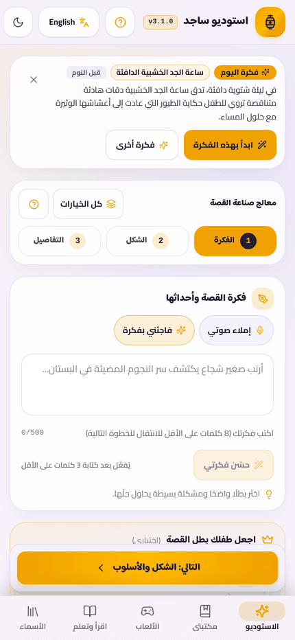<br><sub>الاستوديو وفكرة اليوم</sub></td>
    <td align="center" width="25%">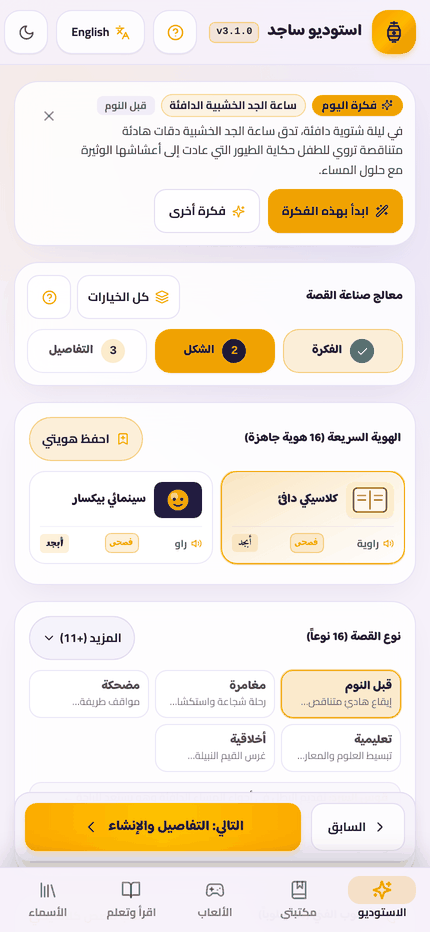<br><sub>الهوية والأسلوب</sub></td>
    <td align="center" width="25%">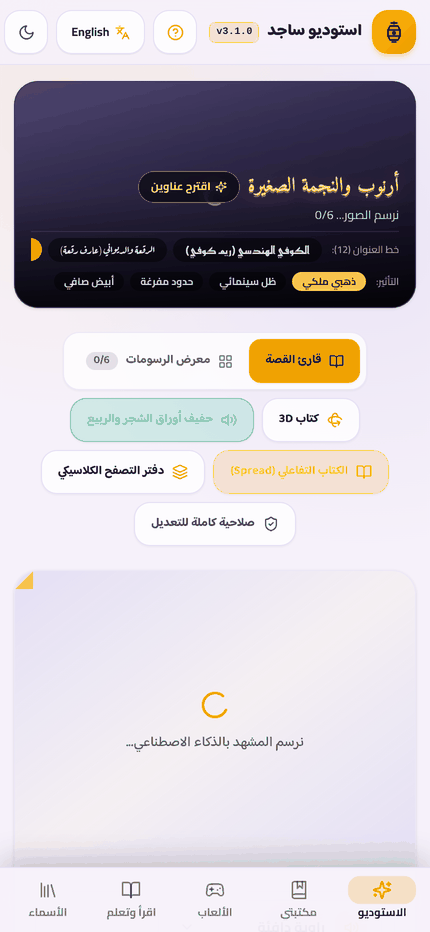<br><sub>رسم الصفحات</sub></td>
  </tr>
  <tr>
    <td align="center">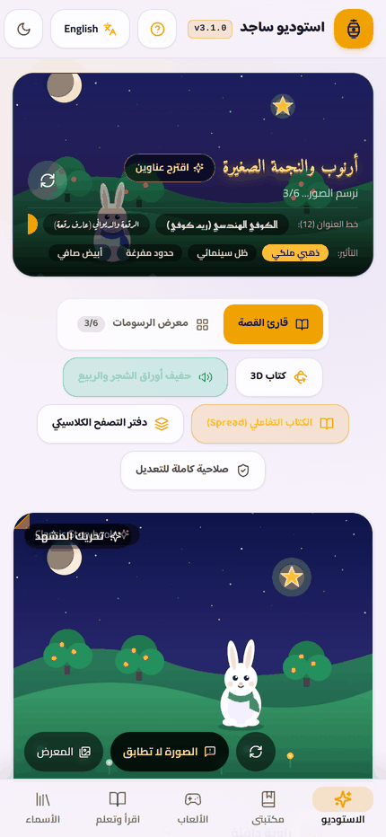<br><sub>الغلاف وطرق القراءة</sub></td>
    <td align="center">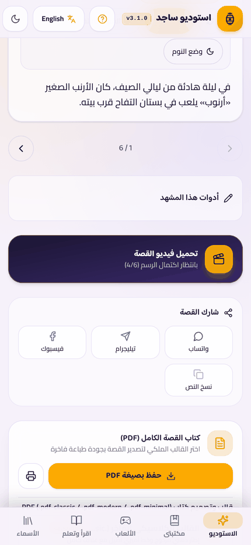<br><sub>الراوي والسرد الصوتي</sub></td>
    <td align="center">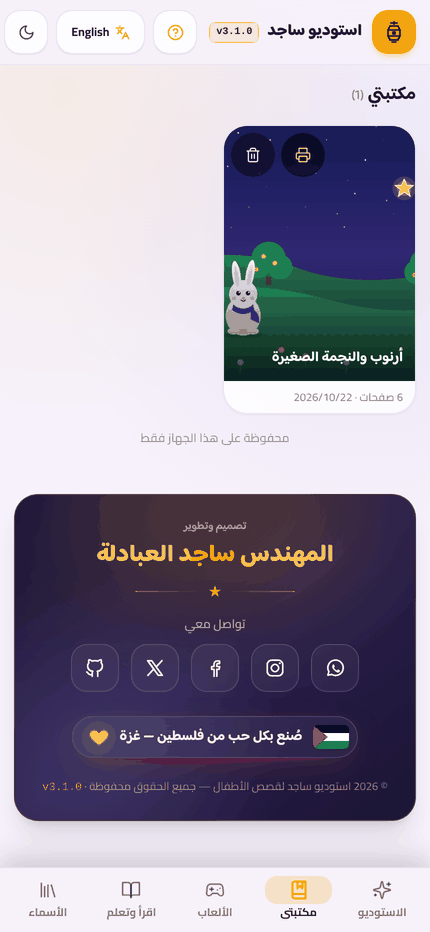<br><sub>مكتبتي</sub></td>
    <td align="center">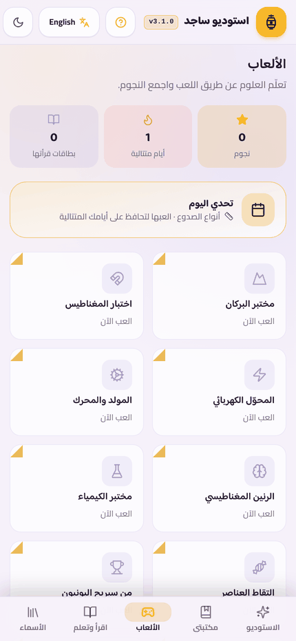<br><sub>الألعاب العلمية</sub></td>
  </tr>
  <tr>
    <td align="center">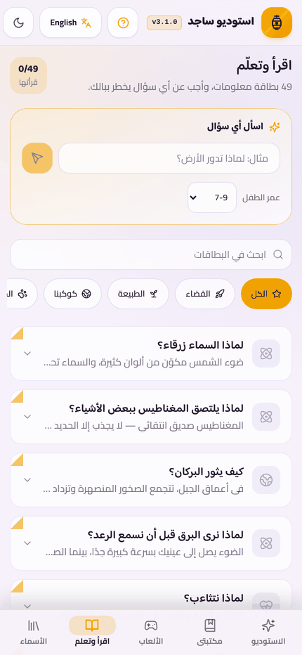<br><sub>اقرأ وتعلّم</sub></td>
    <td align="center">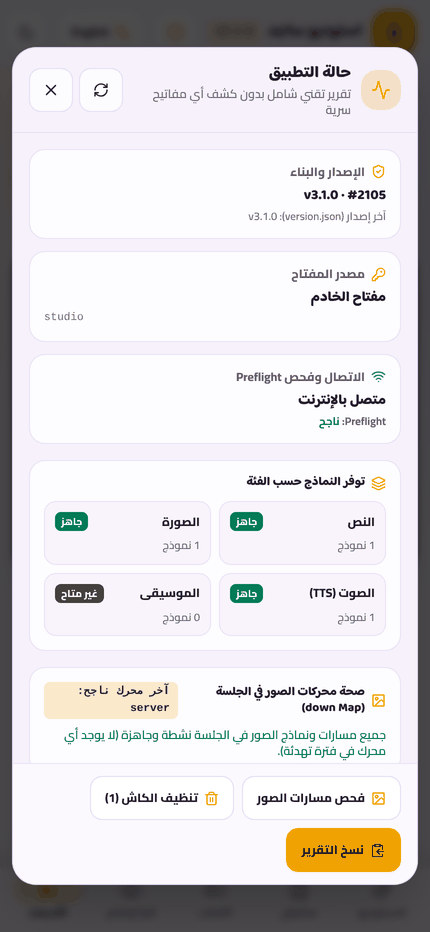<br><sub>حالة التطبيق</sub></td>
    <td align="center">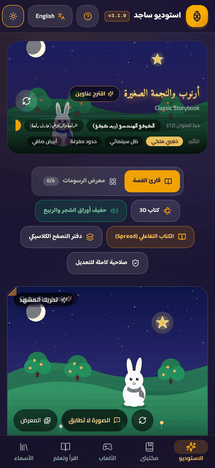<br><sub>الوضع الداكن</sub></td>
    <td align="center">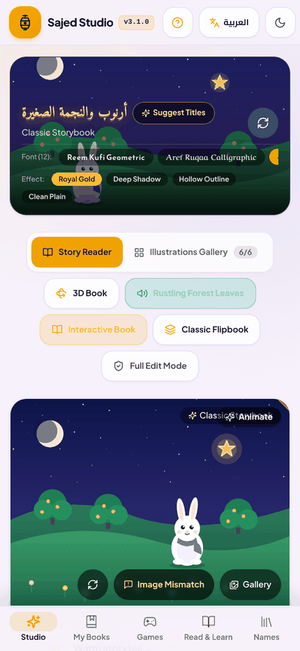<br><sub>الواجهة الإنجليزية</sub></td>
  </tr>
</table>

## المزايا

| | الميزة | التفاصيل |
| :-: | :-- | :-- |
|  | **استوديو من ثلاث خطوات** | الفكرة، ثم الشكل، ثم التفاصيل، مع شريط تنقّل ثابت، وزر «حسّن فكرتي»، وبطاقة «فكرة اليوم»، وإملاء الفكرة بالصوت. |
|  | **هويات وأساليب فنية** | 16 هوية جاهزة تضبط الأسلوب الفني والراوي واللهجة معاً بضغطة واحدة، مع إمكانية حفظ هوياتك الخاصة. |
|  | **16 نوعاً من القصص** | لكل نوع قوس سردي خاص به، من قصص قبل النوم إلى القصص التعليمية والخيالية والتراثية. |
|  | **غلاف بخط عربي مختار** | 12 خطاً عربياً وأربعة تأثيرات للعنوان مع معاينة حيّة قبل الرسم، واقتراح عناوين مناسبة للهجة. |
|  | **راوٍ بصوت طبيعي** | سرد صوتي بتشكيل كامل، وتتبّع للكلمات أثناء القراءة، ووضع نوم، وأصوات محيطة هادئة. |
|  | **لهجات عربية وإنجليزية** | فصحى مشكولة و19 لهجة محلية، وواجهة كاملة بالعربية والإنجليزية. |
|  | **طرق قراءة متعددة** | قارئ القصة، ومعرض الرسومات، وكتاب ثلاثي الأبعاد، وكتاب تفاعلي بصفحتين، ودفتر تصفّح كلاسيكي. |
|  | **ثبات الشخصيات** | ورقة مرجعية للشخصيات تحافظ على مظهر البطل في كل صفحة، وألبوم لحفظ الشخصيات وإعادة استخدامها. |
|  | **رسوم متحركة بالذكاء الاصطناعي** | تحريك رسوم كل صفحة في مقاطع بلا صوت يُدمج معها صوت الراوي والترجمة من التطبيق. المصدر اختياري: دفتر Colab بنموذج Wan عبر طابور Cloudflare (مجاني من رصيدك، نحو 5 ثوانٍ للمقطع) أو Gemini Omni (مدفوع، مع تقدير للتكلفة وموافقة صريحة)، وحركة كاميرا مجانية للصفحات غير المحدّدة. خطوات الإعداد في `cloudflare/video-queue/README.md` و`colab/README.md`. |
|  | **تصدير وطباعة** | ملف PDF بقوالب فاخرة، ومعاينة طباعة بمقاسات A5 وA4 ومربع 21×21، وحزمة ZIP كاملة، وفيديو للقصة. |
|  | **ألعاب علمية** | مختبرات صغيرة تفاعلية، وتحدٍّ يومي، ونجوم تُجمع مع كل إنجاز. |
|  | **اقرأ وتعلّم** | بطاقات معلومات مبسّطة بحسب عمر الطفل، وسؤال حرّ يجيب عنه التطبيق، وقسم «معاني الأسماء». |
|  | **مكتبة محلية** | تُحفظ القصص والصور والصوت على جهازك، مع نسخة احتياطية JSON واستيراد لها. |
|  | **يعمل كتطبيق** | قابل للتثبيت على الهاتف، وهيكله يعمل دون اتصال، ويتحقّق بصمت من وجود إصدار أحدث. |
|  | **حالة التطبيق** | تقرير تشخيصي يعرض الإصدار والاتصال والنماذج المتاحة دون كشف أي مفاتيح سرّية. |
|  | **وضع داكن** | تبديل فوري بين الفاتح والداكن مع احترام تفضيلات الحركة المخفّفة. |

## مسار صناعة القصة

1. **الفكرة**: سطر واحد عن البطل والحدث، أو اقتراح جاهز من «فكرة اليوم».
2. **الشكل**: اختيار الهوية السريعة أو ضبط الأسلوب الفني والراوي واللهجة ونوع القصة وخط الغلاف.
3. **التفاصيل**: الفئة العمرية وطول القصة ونسبة الصفحة.
4. **المعاينة أولاً**: يُرسم الغلاف والصفحة الأولى قبل أي شيء، فتوافق عليهما أو تغيّر الأسلوب قبل رسم باقي الصفحات.
5. **القراءة والاستماع**: بإحدى طرق القراءة الخمس، مع تصحيح أي مشهد لا يطابق النص بضغطة واحدة.
6. **التسليم**: PDF أو حزمة كاملة أو فيديو أو طباعة مباشرة.

## التقنيات

| الطبقة | المستخدم |
| :-- | :-- |
| الواجهة | Vite 6 و React 18 و TypeScript (بوضع صارم) و Tailwind CSS v4 (بخصائص منطقية تدعم RTL) و Framer Motion |
| الخادم | Express 5 وسيطاً خفيفاً لنماذج Gemini، فلا يصل مفتاح الخدمة إلى المتصفح |
| الذكاء الاصطناعي | مكتبة `@google/genai` مع سلاسل نماذج احتياطية للنص والصور والصوت والموسيقى |
| التخزين | قاعدة IndexedDB بمخطط مُرقَّم وترحيل تلقائي، مع نسخ احتياطي بصيغة JSON |
| التصدير | jsPDF و JSZip و WebCodecs مع `mp4-muxer` |
| التثبيت | Web App Manifest و Service Worker بإصدار مرتبط بالبناء |

## التشغيل محلياً

```bash
npm install
export GEMINI_API_KEY="your_key_here"   # server-side only
npm run dev                              # http://localhost:3000
```

للإنتاج:

```bash
npm run build
NODE_ENV=production npm start
```

للفحص الثابت: `npm run lint`. وللاختبار الذاتي داخل التطبيق افتح العنوان `/#test`.

## هيكل المشروع


```text
server.ts              Gemini proxy and generation endpoints
src/
  App.tsx              app shell and navigation
  config.ts            brand and social links (single place to edit)
  version.ts           single source of the version number
  components/
    story/             wizard, reader, export, print preview
    library/ games/ readLearn/ nameMeaning/ layout/ common/
  data/                story types, daily ideas, learning cards
  services/            AI, storage, audio, video, update check
public/                manifest, service worker, app icons
docs/assets/           cover, screenshots and icons used here
```

## الخصوصية والأمان

- مفتاح Gemini يُقرأ من متغيّرات البيئة على الخادم ولا يُرسل إلى المتصفح.
- قصص المستخدم وصوره تبقى في مخزن المتصفح على جهازه، وتُصدَّر منه يدوياً فقط.
- تقرير «حالة التطبيق» ينقّي أي أسرار قبل عرضه أو نسخه.

## سجل الإصدارات

التفاصيل الكاملة في [CHANGELOG.md](CHANGELOG.md). الإصدار الحالي **3.4.1**.

## الحقوق

© 2026 المهندس ساجد العبادلة. جميع الحقوق محفوظة.

التصميم والفكرة والشيفرة والهوية البصرية لهذا المشروع مملوكة لصاحبه. لا يجوز نسخ المشروع أو تعديله أو إعادة توزيعه أو بيعه أو استخدام اسمه وشعاره وهويته دون إذن خطي مسبق من المالك.

## تواصل معي

<p align="center">
  <a href="https://github.com/Dev-saged"></a>&nbsp;&nbsp;
  <a href="https://instagram.com/sajedd.0"></a>&nbsp;&nbsp;
  <a href="https://facebook.com/saged.t"></a>&nbsp;&nbsp;
  <a href="https://x.com/saged_al"></a>
</p>

<br>

<p align="center">
  <br>
  <strong>صُنع بكل حب من فلسطين — غزة</strong><br>
  <sub>المهندس ساجد العبادلة</sub>
</p>

</div>
